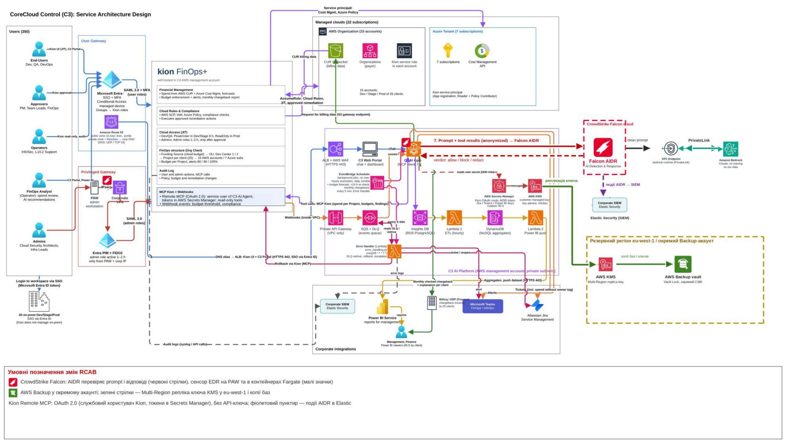
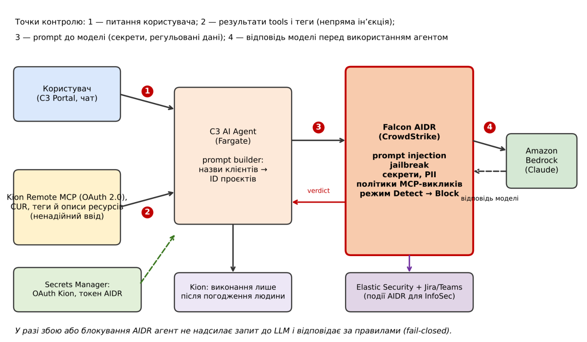
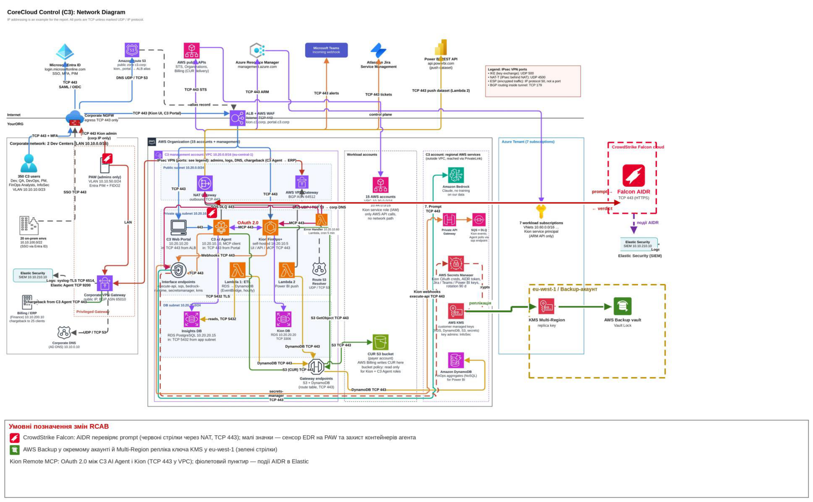
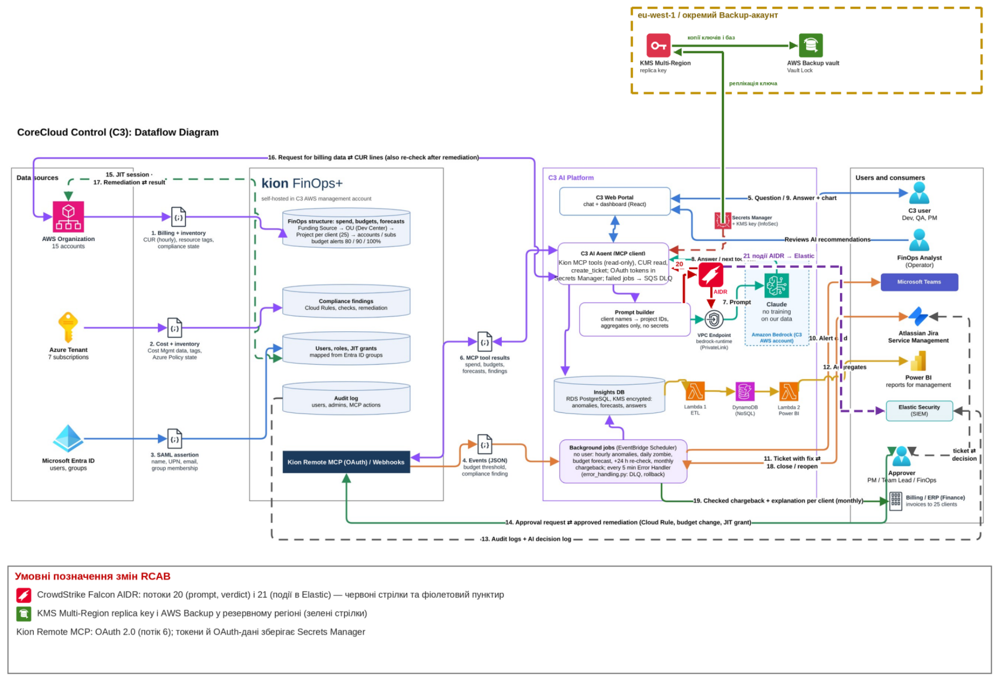
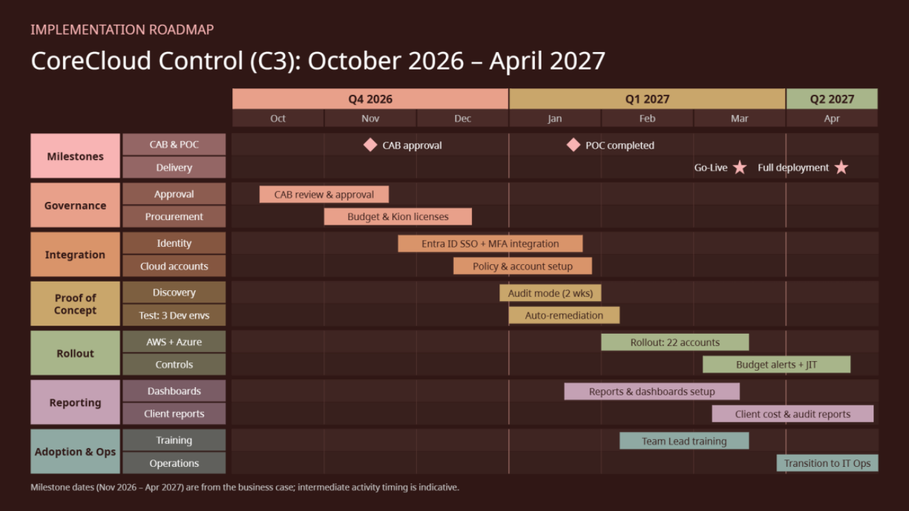
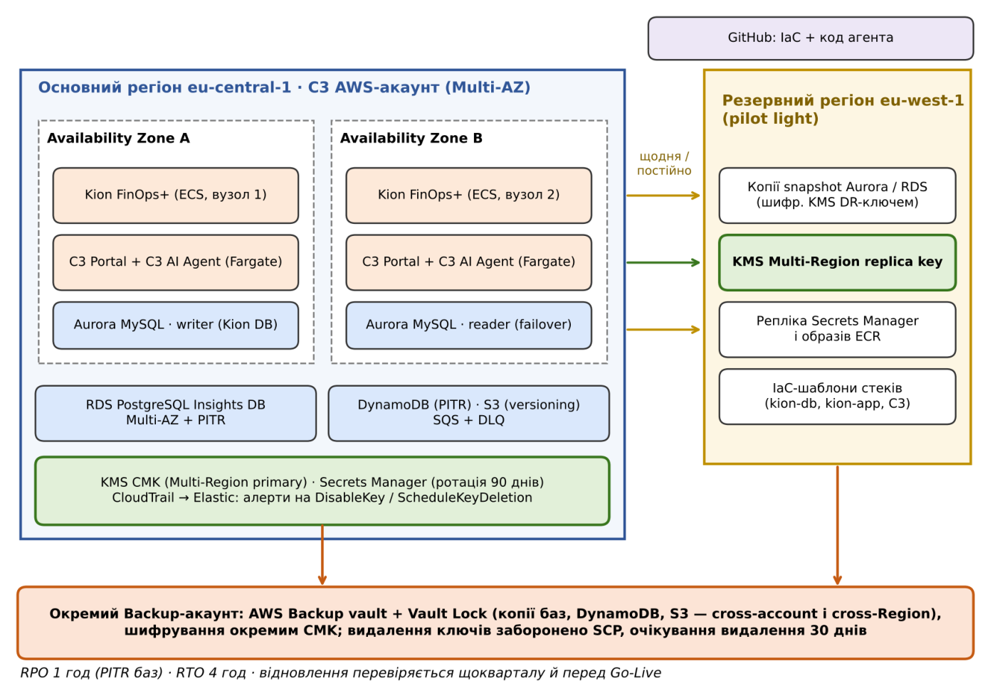

# CoreCloud Control (C3)

Academic cloud security and FinOps design project based on Kion FinOps+.

Lviv Polytechnic National University, 2026 | Academic team project | My role: Service Owner

## Overview

C3 is a proposed platform for centralized cloud governance, cost management and security monitoring. The simulated enterprise has 1,000 employees, 15 AWS accounts, 7 Azure subscriptions and 25 clients. The project covers the concept, service design and release planning stages. It is a conceptual architecture, not a deployed production system.

## My contribution

I prepared the three project stages, including business requirements, architecture diagrams, security controls, risk assessment, budget estimates and deployment and recovery plans.

## Proposed architecture

- Cloud governance and FinOps: Kion FinOps+, AWS and Azure.
- Identity and access: Microsoft Entra ID, SSO, MFA, RBAC and just-in-time access.
- AI integration: Amazon Bedrock, Kion Remote MCP and OAuth 2.0.
- AI security: CrowdStrike Falcon AIDR, prompt injection controls and human approval for production changes.
- Data protection: AWS KMS, Secrets Manager and backup planning.
- Monitoring and operations: Elastic Security, Jira Service Management, Microsoft Teams and Power BI.

## Architecture diagrams

The following diagrams are taken from the updated Release CAB report.

Architecture

Source: Release CAB, page 6.

Ai Security

Source: Release CAB, page 10.

Network

Source: Release CAB, page 15.

Data Flow

Source: Release CAB, page 19.

Deployment Roadmap

Source: Release CAB, page 23.

Backup Recovery

Source: Release CAB, page 30.

## Documentation

| Stage | Document | Language |
| --- | --- | --- |
| Concept CAB | [Business case and roadmap](01-Concept-CAB.pdf) | English |
| Design CAB | [Architecture and security design](02-Design-CAB.pdf) | Ukrainian |
| Release CAB | [Updated design, deployment, operations and recovery plans](03-Release-CAB.pdf) | Ukrainian |

The release report updates the design-stage proposal. Technology names describe the proposed solution, not a claim of production deployment or hands-on experience with every component.

## Learning outcomes

Cloud security architecture, access management, security risk assessment, AI security, FinOps and IT service management.
